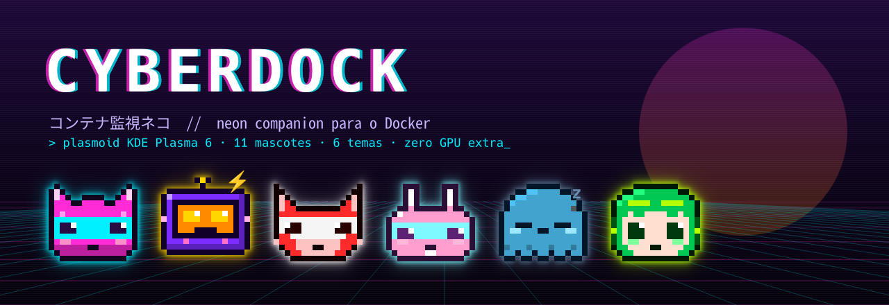
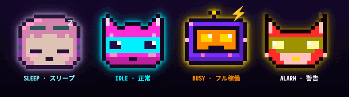
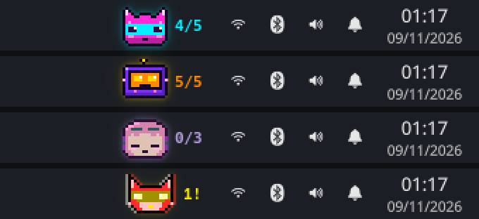
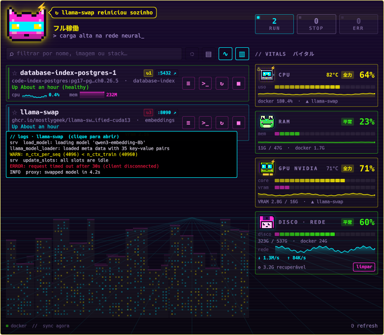
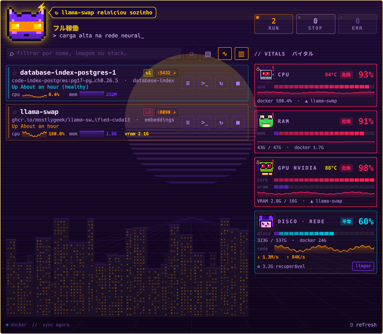
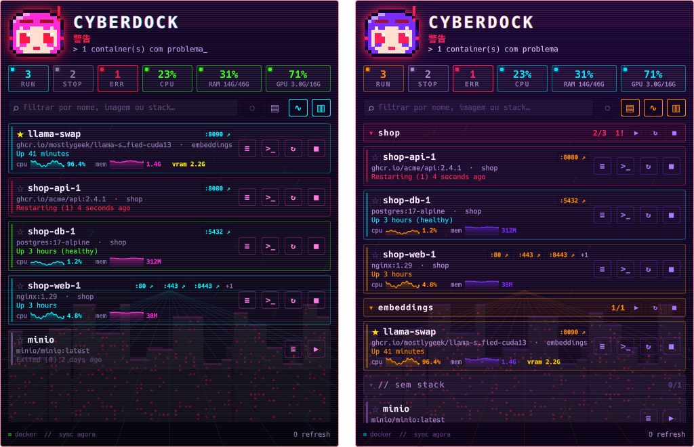
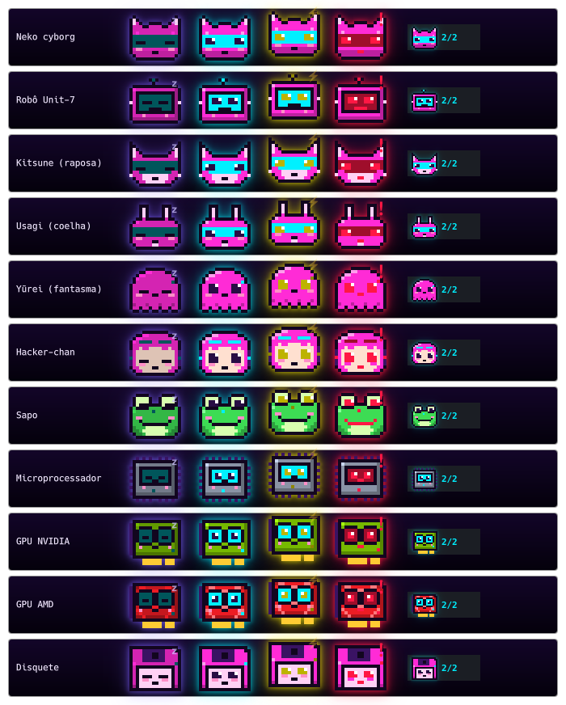
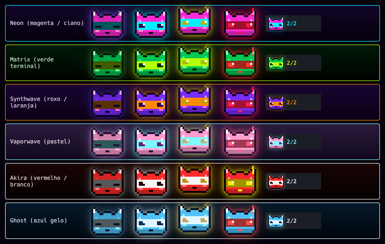
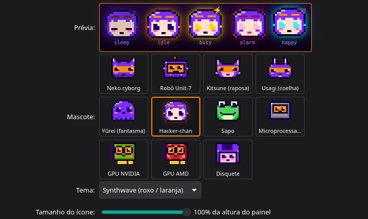

<p align="center">
  
</p>

<p align="center">
  
  
  
  
</p>

**CyberDock** é um widget (plasmoid) para o painel do KDE Plasma 6: uma mascote em pixel art
estilo cyberpunk/anime que vive na sua barra de tarefas e reage ao estado dos seus containers
Docker — dorme quando nada roda, pula quando a GPU esquenta e entra em pânico quando um
container cai. Clique nela para abrir um HUD neon com todos os containers e ações rápidas.

## ⚡ Instalar

```bash
curl -fsSL https://raw.githubusercontent.com/pedroluizmossi/anime-cyber-docker/main/install.sh | bash
```

Depois: botão direito no painel → **Adicionar widgets** → procure **CyberDock** → arraste para o painel.

<sub>O mesmo comando atualiza uma instalação existente. Para remover: `… | bash -s -- --uninstall`.
Não precisa de root nem de clonar o repositório — o script baixa só o pacote do widget e o instala
em `~/.local/share/plasma/plasmoids/` com o `kpackagetool6`.</sub>

**Requisitos:** KDE Plasma 6 · Docker acessível sem `sudo` (usuário no grupo `docker`) ·
Konsole para os botões de logs/shell · `notify-send` (libnotify) para as notificações ·
`nvidia-smi` opcional (GPU e VRAM por container; placas AMD são lidas pelo driver `amdgpu`, sem VRAM por container) · Docker Compose v2 para as ações de stack.

## Humores

<p align="center"></p>

| Humor | Quando | Animação |
|---|---|---|
| 💤 `sleep` | nenhum container rodando | olhos fechados, visor apagado, "z" subindo |
| 😺 `idle` | tudo certo | flutua de leve e pisca |
| ⚡ `busy` | GPU ≥ 40% ou um container com CPU ≥ 60% | pula, olhos e aura amarelos |
| 🚨 `alarm` | container `restarting`/`dead`/`unhealthy`, crash nos últimos 5 min ou Docker fora do ar | treme, glitch RGB, aura piscando, "!" |

Containers parados há muito tempo **não** disparam o alarme — só conta como crash quem
estava rodando e caiu nos últimos 5 minutos.

## No painel

<p align="center"></p>

A mascote fica nítida em qualquer tamanho (a sprite é alinhada à grade de pixels da tela) e mostra
`rodando/total` ao lado — ou `N!` quando há containers com problema.

## HUD

<p align="center"></p>
<p align="center"></p>
<p align="center"></p>

Clique na mascote para abrir o HUD:

- **Contadores** `RUN / STOP / ERR` e o uso de **CPU, RAM e GPU** do computador (com a VRAM usada/total); passe o mouse para ver quanto é do Docker.
- **Coluna de sinais vitais** (`▥`): CPU, RAM e GPU ganham cada um uma mascote cujo humor segue a
  métrica (dorme parada, flutua no normal, pula sob carga, entra em alarme saturada), com barra
  segmentada (parte do Docker em destaque), histórico do último minuto e o container mais pesado.
  Por padrão são o Microprocessador, o Sapo e a placa NVIDIA ou AMD (detectada automaticamente);
  troque em *Configurar → Aparência → Sinais vitais*. Em popups estreitos (< 640 px) volta aos
  quadros compactos do topo.
- **Temperatura** da CPU (hwmon: `coretemp`/`k10temp`/`zenpower`) e da GPU nos cartões: acima do limite
  "quente" a mascote sua, solta vapor e pula; acima do "crítico" entra em alarme. Limites em
  *Configurar → Comportamento → Temperatura*.
- **Disco · rede**: uso do disco onde fica o Docker (parte do Docker em destaque), tráfego de rede
  ao vivo e o espaço recuperável, com botão **limpar** (dois cliques) que roda
  `docker image prune -af` + `docker builder prune -f`.
- **A mascote comenta**: um balão de fala aparece quando um container cai, entra em loop, fica
  unhealthy ou reinicia sozinho — e ela comemora (humor `happy` ♥) quando ele volta.
- **Prévia de logs**: passe o mouse no `≡` para ver as últimas linhas (erros em vermelho, avisos em
  amarelo) sem abrir o terminal.
- **Visual vivo**: horizonte cyberpunk em pixel art atrás da lista (mais janelas acesas com a CPU,
  chuva neon no alarme), fundo animado por tema (chuva Matrix, sol Synthwave, estrelas Vaporwave,
  neve Ghost, linhas de velocidade Akira), varredura de CRT ao abrir o popup, números que contam,
  barras que acendem em sequência e contadores com LED e efeito de placa de flip. Cartões
  compactos automáticos quando não cabem.
- **Mascotes interativas**: clique numa mascote do HUD para um carinho, clique duplo para ela dançar;
  no alarme as mascotes dos cartões olham para a principal.
- **Contador de reinícios** `↻N` por container (RestartCount do Docker), piscando em vermelho
  quando subiu nos últimos 10 minutos.
- **Mini-gráficos de CPU e memória** dos últimos minutos em cada container, e a **VRAM por container**
  (o processo na GPU é ligado ao container dono pelo cgroup) — ótimo para servidores de LLM.
- **Portas clicáveis:** `:8090 ↗` abre `http://localhost:8090` no navegador.
- **Stacks do Compose:** agrupe por projeto (`▤`), recolha grupos e use ▶ ↻ ■ para iniciar,
  reiniciar ou parar a stack inteira (`docker compose -p <projeto> …`).
- **Busca e filtros:** filtre por nome, imagem ou stack, oculte os parados (`◌`) e ligue/desligue os gráficos (`∿`).
- **Favoritos:** ☆ fixa um container no topo da lista.
- Ações por container: **logs** (Konsole), **shell** (`docker exec`), **reiniciar**, **parar**, **iniciar**.

## Notificações

O CyberDock avisa pelo sistema de notificações do KDE quando um container **cai**, entra em
**loop de reinício** ou fica **unhealthy** — com botões **Ver logs** e **Reiniciar** na própria
notificação. Também avisa quando o container volta ao normal e quando o Docker sai do ar (dá para
desligar cada tipo em *Comportamento*). No máximo uma notificação por minuto para o mesmo evento.

## 11 mascotes

<p align="center"></p>

**Neko cyborg** · **Robô Unit-7** · **Kitsune** · **Usagi** · **Yūrei** · **Hacker-chan** ·
**Sapo** · **Microprocessador** · **GPU NVIDIA** · **GPU AMD** · **Disquete** — qualquer uma pode ser a
mascote do painel ou de um cartão de sinal vital.

## 6 temas (+ personalizado)

<p align="center"></p>

Neon · Matrix · Synthwave · Vaporwave · Akira · Ghost — ou **Personalizado**, escolhendo as cores
do pelo e do visor. O tema vale para tudo: mascote, aura, HUD, botões e tooltips.

## Configurações

<p align="center"></p>

Botão direito na mascote → **Configurar CyberDock…**

**Aparência** — com prévia ao vivo dos 4 humores
- **Mascote:** galeria clicável com as 11 mascotes, mais a mascote de cada cartão de sinal vital.
- **Tema:** os 6 temas ou Personalizado.
- **Tamanho do ícone:** 50–100% da altura do painel.
- **Intensidade do glow:** 0 (desligado) a 100%.
- **Mostrar contador** `rodando/total` (o alerta `N!` aparece mesmo desligado).
- **Animações:** desligue para uma mascote estática.

**Comportamento**
- Intervalo de atualização (1–60 s; CPU/mem/VRAM são lidas no dobro do intervalo, mínimo 5 s).
- Limites do modo ⚡ busy: uso da GPU (%) e CPU de um container (% por núcleo).
- Notificações: problemas, recuperação e Docker fora do ar.

Os filtros do HUD (agrupar, ocultar parados, gráficos) e os favoritos ficam salvos automaticamente.

## Desempenho

A animação praticamente não custa GPU: a sprite só é redesenhada quando algo visível muda
(piscada, cor dos olhos, glitch, LED), flutuar e pular são apenas deslocamentos, o glow é
recalculado só quando muda humor/tema/mascote/tamanho e as animações do HUD pausam com ele
fechado. No humor `idle` são ~4 redesenhos a cada 10 s. Medido numa RTX 4070 Ti SUPER:
23,8 W com animação × 23,9 W sem.

## Criar mascotes e temas

**Mascote:** adicione uma grade 16×14 em [`Sprites.js`](package/contents/ui/Sprites.js) e inclua a
chave em `order`. Os caracteres são *papéis* de cor, então qualquer tema funciona com qualquer mascote:

| | papel | | papel |
|---|---|---|---|
| `K` | contorno | `C` | visor |
| `P` | cor principal | `E` / `W` | olho / brilho do olho |
| `S` / `H` | sombra / brilho da principal | `B` | blush |
| `M` | detalhe claro (orelha, focinho) | `T` | boca |
| `F` | pele | `D` | hardware (fones) |
| `A` | LED que acompanha o humor | `.` | transparente |

`eyeBg` é o papel desenhado no lugar do olho quando ele fecha. Valide com `python3 dev/check-sprites.py`.

**Tema:** adicione uma paleta em [`Themes.js`](package/contents/ui/Themes.js) e inclua a chave em `order`.

## Desenvolver

```bash
git clone https://github.com/pedroluizmossi/anime-cyber-docker.git && cd anime-cyber-docker
./install.sh                                  # instala a partir do clone
systemctl --user restart plasma-plasmashell   # recarrega o widget no painel
plasmawindowed com.pedro.cyberdock            # roda numa janela isolada, com dados reais
```

Previews com dados de exemplo (salvam PNG, não precisam do Plasma):

```bash
qml6 dev/preview-mascots.qml -- neon /tmp/m.png        # todas as mascotes num tema
qml6 dev/preview-themes.qml -- /tmp/themes.png         # todos os temas
qml6 dev/preview-hud.qml -- 1 neon - /tmp/hud.png      # HUD: agrupar 0|1, tema, busca|-
qml6 dev/preview-full.qml -- alarm /tmp/full.png       # popup: sleep | idle | busy | alarm
node dev/test-logic.mjs                                # testes da lógica (portas, filtros, eventos…)
qml6 dev/preview-config.qml -- synthwave /tmp/cfg.png  # página de configuração
QT_FORCE_STDERR_LOGGING=1 qml6 dev/preview-perf.qml    # conta redesenhos por humor
python3 dev/check-sprites.py                           # valida as grades das mascotes
dev/make-docs.sh                                       # regera as imagens deste README
```

<details>
<summary>Estrutura do projeto</summary>

```
install.sh                  # instalador (local ou via curl | bash)
package/
  metadata.json
  contents/ui/
    main.qml                # coleta (docker ps/stats, nvidia-smi), humor, notificações e ações
    Logic.js                # lógica pura: portas, filtros/grupos, eventos, bytes (testada)
    Mascot.qml              # sprite em Canvas + glow (MultiEffect) + animações
    Sprites.js              # desenhos das mascotes (papéis de cor)
    Themes.js               # paletas dos temas
    CompactView.qml         # visão do painel
    FullView.qml            # HUD (scanlines, glitch no título)
    ContainerRow.qml        # linha de container: portas, sparklines, VRAM, favorito, ações
    StackHeader.qml         # cabeçalho de stack do Compose
    Sparkline.qml           # mini-gráfico
    ToolTipLite.qml
    configAppearance.qml    # página "Aparência"
    configBehavior.qml      # página "Comportamento"
  contents/images/
    cyberdock.png           # ícone das notificações
  contents/config/
    main.xml                # chaves de configuração (KConfigXT)
    config.qml              # páginas do diálogo de configuração
dev/                        # previews, validação e gerador das imagens
docs/img/                   # imagens do README
```

</details>

## Licença

[MIT](LICENSE) — as mascotes e temas são originais deste projeto.
